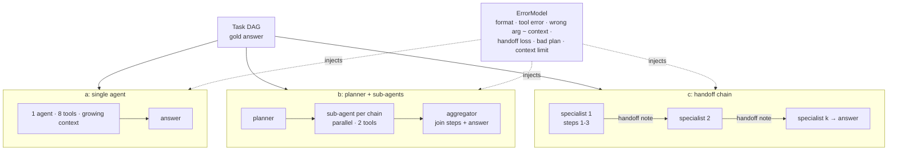

# harness-bench

The same task suite run through three agent harnesses — **(a) one agent with tools**, **(b) planner + parallel sub-agents**, **(c) a handoff chain of specialists** — reporting success, cost, latency and failure types, plus a write-up on when one agent beats five.

> **Everything here is a SIMULATION.** The model is a mock with injected errors (`mock_llm.py`); prices and latencies are illustrative assumptions, not provider quotes. All numbers below come from `results/bench.json`. Conclusions are conditional on the error model; the sweeps show where they flip.

## What it is
- `tasks.py` — 4 task families built as DAGs of tool steps with a computable gold answer: `simple` (2-step chain), `deep` (8-step chain), `wide` (8 independent lookups), `mixed` (two 3-step chains + a join).
- `mock_llm.py` — `ErrorModel` with explicit, documented error rates; token billing; a latency model (TTFT + prefill + decode).
- `harnesses.py`
  - `single` — 1 agent, all 8 tool schemas, one context that grows with every step.
  - `planner` — planner call → one sub-agent per independent chain (2 tools each, run in parallel) → aggregator does join steps and answers.
  - `handoff` — specialists of 3 steps each, passing a handoff note of every value so far.
- `bench.py` — 50 tasks × 4 families × 4 trials per harness (800 runs each), then sweeps of the two assumptions that decide the winner.

## Why
"Multi-agent" is often the default architecture. But every extra agent adds a prompt to pay for, a plan that can be wrong, and a handoff that can drop information. A single agent avoids those costs but carries a long context, and long contexts raise its error rate. This bench makes both failure sources explicit and measures the trade.

## Architecture


## How it works
Error model defaults (assumptions, in `results/bench.json → error_model`):

| Error | Default | Effect |
|---|---|---|
| malformed call | 3% / call | retry (max 2), then `format` failure |
| tool transient | 3% / call | retry (max 2), then `tool_error` failure |
| wrong argument | 1% + 1.2% per 1k context tokens | value silently wrong → `wrong_arg` |
| handoff loss | 8% per value passed | receiver re-asks with p = 0.6, else value garbled → `handoff_loss` |
| bad plan | 0.8% per task step | one sub-task result wrong → `bad_plan` |
| context limit | 6,000 tokens | `context_overflow` |

Pricing assumption: $0.15 / M input, $0.60 / M output; latency 0.25 s TTFT + 0.03 s per 1k prompt tokens + 12 ms per output token. Parallel sub-agents count the slowest branch.

## Results (SIMULATED; 200 runs per cell; 800 per harness)

| family | harness | success | cost / 1k tasks (USD) | tokens | calls | p50 s | p95 s | agents | failures |
|---|---|---|---|---|---|---|---|---|---|
| simple | single | 0.975 | 0.428 | 2419 | 3.1 | 2.50 | 3.25 | 1 | wrong_arg 5 |
| simple | planner | 0.945 | 0.446 | 2240 | 5.2 | 4.19 | 4.93 | 3 | handoff_loss 6, wrong_arg 3, bad_plan 2 |
| simple | handoff | 0.985 | 0.269 | 1361 | 3.1 | 2.47 | 3.21 | 1 | wrong_arg 3 |
| deep | single | 0.840 | 1.851 | 11136 | 9.5 | 7.11 | 8.65 | 1 | wrong_arg 32 |
| deep | planner | 0.770 | 1.633 | 8844 | 11.6 | 10.90 | 12.41 | 3 | wrong_arg 30, bad_plan 11, handoff_loss 5 |
| deep | handoff | 0.815 | 1.374 | 7644 | 11.6 | 8.71 | 10.21 | 3 | wrong_arg 26, handoff_loss 11 |
| wide | single | 0.775 | 1.852 | 11145 | 9.5 | 7.11 | 8.65 | 1 | wrong_arg 45 |
| wide | planner | 0.685 | 1.456 | 6800 | 18.9 | 6.11 | 6.86 | 10 | handoff_loss 37, wrong_arg 20, bad_plan 6 |
| wide | handoff | 0.645 | 1.394 | 7772 | 11.9 | 9.22 | 10.47 | 3 | handoff_loss 42, wrong_arg 29 |
| mixed | single | 0.875 | 1.566 | 9361 | 8.5 | 6.33 | 7.86 | 1 | wrong_arg 25 |
| mixed | planner | 0.845 | 1.161 | 5788 | 11.6 | 7.49 | 8.98 | 4 | wrong_arg 14, bad_plan 11, handoff_loss 6 |
| mixed | handoff | 0.835 | 1.193 | 6572 | 10.6 | 7.95 | 9.45 | 3 | wrong_arg 18, handoff_loss 15 |

Overall (800 runs each): single 0.866 success, $1.424 / 1k tasks, p50 7.11 s · planner 0.811, $1.174, p50 7.49 s · handoff 0.820, $1.058, p50 8.71 s.

**Sweeps** (deep + wide only, separate seed, 200 runs per cell; the 0.012 / 0.08 rows repeat the defaults, so compare them to the table above to see ~±3 points of run-to-run noise):

| param | value | family | single | planner | handoff |
|---|---|---|---|---|---|
| p_wrong_per_1k_ctx | 0.0 | deep | 0.945 | 0.880 | 0.930 |
| p_wrong_per_1k_ctx | 0.0 | wide | 0.900 | 0.620 | 0.655 |
| p_wrong_per_1k_ctx | 0.012 | deep | 0.845 | 0.810 | 0.875 |
| p_wrong_per_1k_ctx | 0.012 | wide | 0.805 | 0.610 | 0.615 |
| p_wrong_per_1k_ctx | 0.024 | deep | 0.765 | 0.765 | 0.835 |
| p_wrong_per_1k_ctx | 0.024 | wide | 0.725 | 0.580 | 0.580 |
| p_wrong_per_1k_ctx | 0.048 | deep | 0.605 | 0.675 | 0.755 |
| p_wrong_per_1k_ctx | 0.048 | wide | 0.550 | 0.550 | 0.530 |
| p_handoff_loss | 0.0 | deep | 0.845 | 0.835 | 0.900 |
| p_handoff_loss | 0.0 | wide | 0.805 | 0.880 | 0.865 |
| p_handoff_loss | 0.04 | wide | 0.805 | 0.740 | 0.710 |
| p_handoff_loss | 0.16 | wide | 0.805 | 0.510 | 0.500 |

(Full sweep incl. 0.006 and every deep row: `results/bench.md`.)

## When one agent beats five
Under these assumptions:
1. **One agent wins on success when handoffs are lossy.** With 8% loss per passed value, the single agent has the best success in every family except `simple`, where the one-agent handoff harness is effectively the same thing. On `wide` the 10-agent planner loses 9 points (0.685 vs 0.775); 37 of its 63 failures are handoff losses.
2. **The crossover is handoff fidelity, not task shape alone.** Set handoff loss to 0 and the planner wins `wide` (0.880 vs 0.805) and the handoff chain wins `deep` (0.900 vs 0.845). Already at 4% loss the single agent leads again on `wide`.
3. **Long context is the single agent's weak point.** When wrong-argument errors grow faster with context (0.048 per 1k tokens), the handoff chain wins `deep` (0.755 vs 0.605): small fresh contexts beat one long one.
4. **On the longer tasks, multi-agent is cheaper per task; only the planner is also faster, and only on wide work.** On the 7–8-step families sub-agents re-read short contexts, so planner and handoff use ~20–40% fewer tokens than single (e.g. `wide`: 6,800 vs 11,145). Parallel sub-agents give the lowest `wide` latency (p50 6.11 s vs 7.11 s) despite 2× the calls. The handoff chain is slower on `wide` (p50 9.22 s), and on `simple` the planner costs slightly more than single ($0.446 vs $0.428 per 1k tasks). On `deep` the planner adds pure overhead: +3.8 s p50 for the planning step, with nothing to parallelise.
5. **Rule of thumb from this model:** use one agent until its context gets long enough to hurt accuracy, and split only where the work is truly parallel *and* you can make handoffs reliable (structured values, not prose notes; verification on receipt).

## Tests
28 tests (`pytest -q`): task gold and branch decomposition, error-model math, cost math, every harness × family succeeds with errors off (12), planner parallelism, chain grouping, context re-read cost, and attribution of each injected failure type (format retries, context overflow, wrong-arg propagation, unrecovered and recovered handoff loss, bad plan), reproducibility of the bench.

```bash
pip install pytest
python -m pytest -q
python -m harness_bench.bench   # < 1 s, deterministic seeds
```

## Limits
- **No real model.** Every rate in the error model is an assumption. The sweeps show that changing two of them reverses the ranking, so treat the conclusions as conditional, not as measurements of any provider.
- Errors are independent draws. Real failures correlate (a confused model stays confused); planners also fail in richer ways than one bad sub-result.
- Tasks are synthetic arithmetic DAGs; there is no open-ended reasoning, no tool selection among similar tools, no verification step in any harness.
- A run on a real small model (e.g. a local 1–3B model) with the same harness code is the obvious next step and was not done here.

## License
MIT
